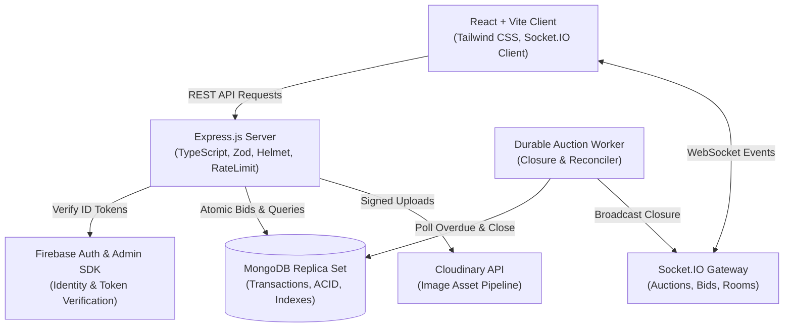

# CampusBid Architecture Documentation

## 1. System Overview

CampusBid is a campus-oriented second-hand auction marketplace engineered for fairness, consistency, and transparent bidding. The platform consists of:

- **Frontend (Client)**: A modern, responsive React + TypeScript Single Page Application built with Vite and Tailwind CSS. Provides real-time auction views via Socket.IO, responsive bidding interfaces, search & filtering, watchlists, dashboards, and an AI assistant.
- **Backend (Server)**: A Node.js + Express + TypeScript service exposing modular REST APIs and Socket.IO real-time channels. Handles authenticated user profiles, listing lifecycles, transaction-safe manual and automatic bidding, durable auction closure, and notifications.
- **Database (MongoDB)**: Source of truth for all users, listings, accepted bids, proxy bids, sales, questions, and notifications. Uses Mongoose with strict schema validation and multi-document transactions.
- **Image Storage (Cloudinary)**: Backend-signed uploads and asset management with secure URLs and public IDs.
- **Identity Provider (Firebase Auth)**: Authentication via Google Sign-In and Email/Password with verification. Backend verifies JWT ID tokens via Firebase Admin SDK.

## 2. Architecture Diagram

## 3. Key Design Principles

1. **Transaction Safety**: All bidding actions (manual, proxy raises, auction extensions) execute inside MongoDB transactions on a replica set. If transactions are unsupported or fail, the operation fails safely without corrupting auction state.
2. **Authoritative Backend**: The server is the single source of truth for auction status, minimum next bid, closing timestamps, and winner determination. Client-side state is never trusted for financial or lifecycle operations.
3. **Monetary Precision**: All currency amounts are stored and calculated as integer **paise** (1 Rupee = 100 Paise) to completely eliminate floating-point arithmetic errors. Rupee conversion happens strictly at UI boundaries.
4. **Append-Only Bid Ledger**: Bids once accepted are immutable audit records. Public displayed price is denormalized on the listing for performance but synchronized atomically with the bid ledger.
5. **Private Proxy Maximums**: Automatic bidding maximum amounts are strictly protected and never leaked in public endpoints, logs, or Socket.IO events.
6. **Graceful Degradation**: Core marketplace browsing and bidding functions operate without requiring paid AI services or live Cloudinary keys (mock adapters provided).
