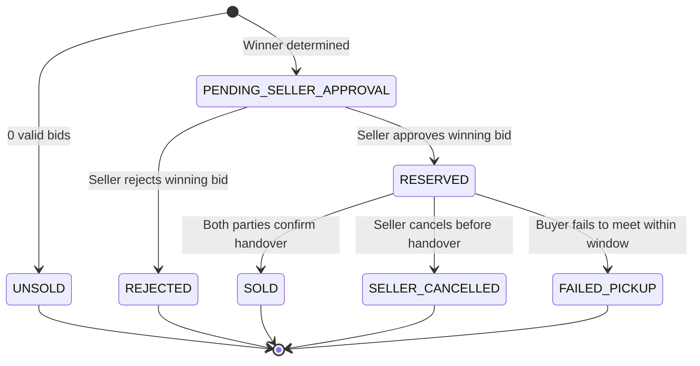

# CampusBid Auction Rules & Proxy Bidding Specification

## 1. Monetary Unit & Precision

All internal monetary values in the database, API payloads, calculations, and socket events are handled strictly as **integer paise** (1 INR = 100 paise).
- Example: Starting price of ₹500 is stored as `50000`.
- Minimum increment of ₹25 is stored as `2500`.
- Float arithmetic is prohibited in price comparison and summation.

## 2. Manual Bidding Rules

1. **First Bid**: When an auction has 0 accepted bids, the minimum acceptable bid is exactly the `startingPricePaise`.
2. **Subsequent Bids**: When an auction has existing accepted bids, the minimum acceptable bid is:
   $$\text{minNextBid} = \text{currentPricePaise} + \text{minBidIncrementPaise}$$
3. **Seller Self-Bidding**: Sellers are strictly prohibited from bidding on their own listings.
4. **Auction Eligibility**: Bids are rejected immediately if:
   - The listing status is not `ACTIVE` or `EXTENDED`.
   - The current server timestamp is $\ge \text{closingAt}$.
5. **Atomic Ledger**: Every accepted bid creates an immutable document in the `bids` collection and atomically updates `currentPricePaise`, `leadingBidderId`, and `bidCount` on the `Listing` inside a MongoDB transaction.

## 3. Anti-Sniping (Last-Second Extension) Rule

To ensure fair competition and prevent latency exploitation (sniping):
- If any valid manual or automatic bid is accepted within **30 seconds** of `closingAt` ($\text{closingAt} - \text{now} \le 30\,\text{seconds}$), the auction closing time is extended:
  $$\text{newClosingAt} = \text{bidTimestamp} + 60\,\text{seconds}$$
- The listing status is set to `EXTENDED` (if not already).
- All watchers and room participants receive the updated `closingAt` via WebSocket event.
- Rejected bids never trigger an extension.

## 4. Proxy (Automatic) Bidding Algorithm

Buyers can configure a private `maxAmountPaise` on an auction. The platform automatically bids on their behalf up to this ceiling.

### Core Proxy Invariants
1. **Confidentiality**: The `maxAmountPaise` is never transmitted to other clients, included in public API responses, or logged.
2. **Minimum Effective Raise**: The proxy engine only bids the minimum amount required to secure or retain the lead.
3. **Never Exceed**: An automatic bid never exceeds the buyer's configured maximum.

### Scenarios and Resolution Logic

#### Scenario A: First Bid Placed with AutoBid
- If a user configures an AutoBid with max $M \ge \text{startingPrice}$, and there are 0 bids:
  - System registers the AutoBid.
  - Automatically posts an opening bid at $\text{startingPrice}$.
  - The bidder becomes the leader at `currentPrice = startingPrice`.

#### Scenario B: Manual Bid Arrives Against Existing AutoBid
- Suppose User A has AutoBid with max $M_A$, currently leading at $P$.
- User B submits a manual bid $B$.
  - **Case 1: $B > M_A$**:
    - User B's bid is accepted at amount $B$. User B takes the lead. User A is outbid.
  - **Case 2: $B \le M_A$**:
    - User B's bid $B$ is recorded.
    - System immediately generates an automatic response bid for User A:
      $$\text{AutoBid Amount} = \min(M_A, B + \text{minBidIncrementPaise})$$
    - User A retains the lead at the new amount.

#### Scenario C: Competing AutoBids (Tie-Breaking & Resolution)
- When two users configure AutoBids ($M_1$ and $M_2$):
  - **If $M_1 \ne M_2$**: The user with the higher maximum wins the lead. The resulting current price is set to:
    $$\text{currentPrice} = \min(\text{higherMax}, \text{lowerMax} + \text{minBidIncrementPaise})$$
  - **If $M_1 = M_2$ (Equal Maximums)**: **First to configure wins.** The user who submitted their AutoBid configuration earlier holds the lead at the tied amount. The later AutoBid is outbid.

## 5. Sale Lifecycle Transitions

When an auction reaches `closingAt`, the durable closure engine finalizes the auction:

1. **UNSOLD**: No valid bids received before closing.
2. **PENDING_SELLER_APPROVAL**: provisional winner determined; waiting for seller to accept the final price.
3. **RESERVED**: Seller accepted the price. Item is reserved for the buyer to arrange handover.
4. **SOLD**: Both seller and buyer mark handover as confirmed. Transaction complete.
5. **FAILED_PICKUP / SELLER_CANCELLED**: Handover window expired or cancelled with recorded reason.
